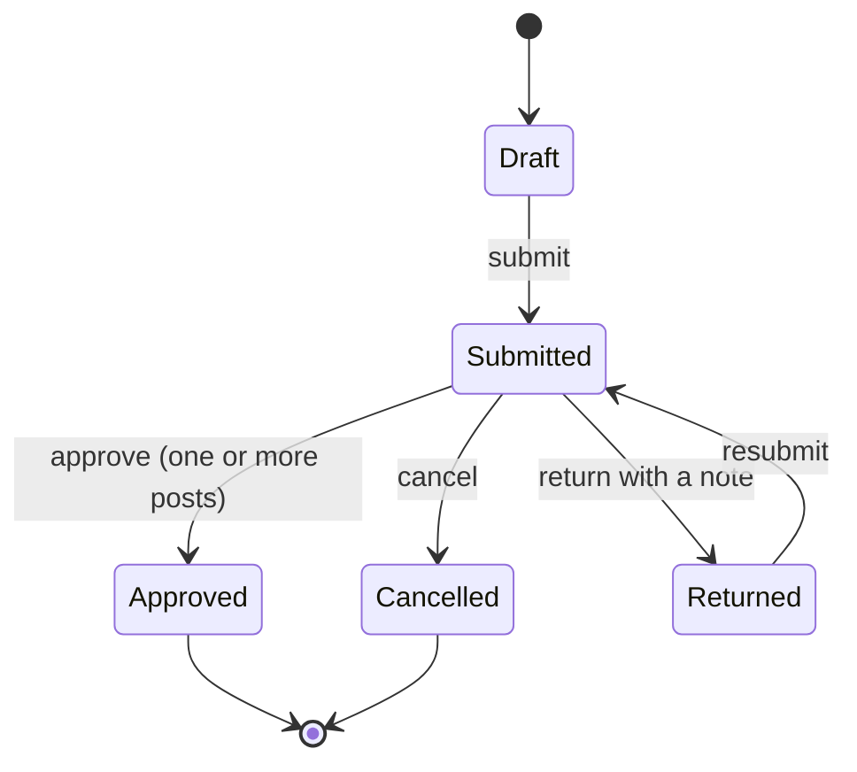
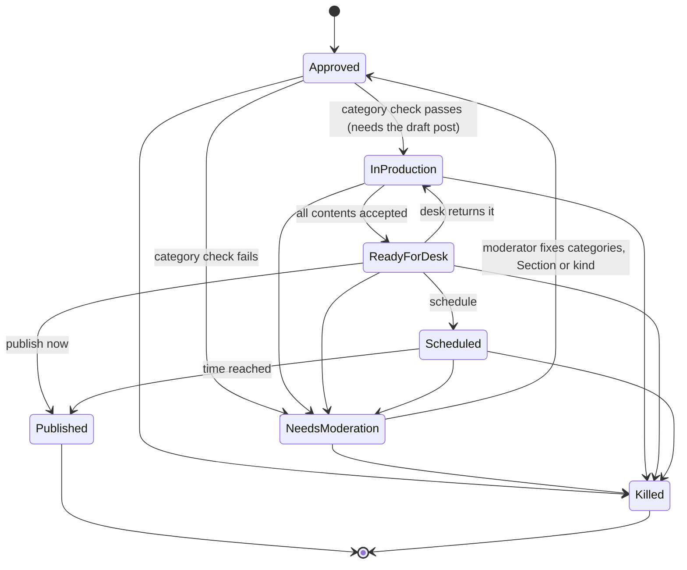

:::note[Status: built (N1 and N2)]
Proposals, moderation and post projects are merged in
[`ModularBlazor.Module.NewsRoom`](https://github.com/soft-square-net/ModularBlazor.Module.NewsRoom) (PRs #1 and #2).
The routes are under `/api/newsroom`. Every change carries the `version` the caller read, and answers **409** when it
changed since.
:::

## Proposal

A proposal is a member's story idea. It belongs to an Organization **unit**. Its form is the DynamicFields field
**`proposal.default`**, so a tenant can extend it with its own fields. DynamicFields has no starter for it: each tenant
creates it once from `docs/proposal.default.json` in the repository (needs `dynamicfields.manage`). The default form
has:

- a **title** (required);
- an optional **image**, **body** and other fields the tenant adds;
- **suggested categories**: post categories from Contents (at most 20, not checked against Content yet). They become
  the initial categories of each post made from the proposal.

- The author edits and submits it while it is **Draft** or **Returned**, and may delete a Draft. An author cannot
  withdraw a submitted proposal.
- Only a moderator moves it out of **Submitted**. Return needs a note; cancel may have one.
- A draft is visible to its author only. A proposal the caller may not see answers **404**.
- Events: `newsroom.proposal-submitted.v1` and `newsroom.proposal-decided.v1` (approved, cancelled or returned),
  written to the outbox in the same save. The records are in `NewsRoom.Contracts`, which is not published as a package
  yet.

| Method and route | Permission | What it does |
| --- | --- | --- |
| `GET /proposals/mine?state=&page=&pageSize=` | `newsroom.propose` | The caller's proposals, newest first |
| `GET /proposals/queue?state=&unitId=&page=&pageSize=` | `newsroom.moderate` | The queue of the units the caller moderates (default `Submitted`), oldest first |
| `GET /proposals/{id}` | `newsroom.propose`, `newsroom.moderate` or `newsroom.workflow` | One proposal with its values |
| `POST /proposals` `{ unitId, values, suggestedCategories }` | `newsroom.propose` | A new draft: 201 |
| `PUT /proposals/{id}` `{ version, unitId, values, suggestedCategories }` | `newsroom.propose` | The author's edit |
| `DELETE /proposals/{id}?version=` | `newsroom.propose` | The author deletes a draft |
| `POST /proposals/{id}/submit` `{ version }` | `newsroom.propose` | Check against the form, then submit |
| `POST /proposals/{id}/return` `{ version, note }` | `newsroom.moderate` | Back to the author |
| `POST /proposals/{id}/cancel` `{ version, note }` | `newsroom.moderate` | Refused for good |
| `POST /proposals/{id}/approve` `{ version, note, projects }` | `newsroom.moderate` | Approve into post projects (below) |

A draft may be incomplete. **Submit** checks the values against the newest published `proposal.default`, and only a
`valid: true` report passes:

| Status | When |
| --- | --- |
| 422, with `problems: [{ path, message }]` | The values do not match the form, or there is no `title` (NewsRoom always needs one) |
| 409 | The tenant has no published `proposal.default`, or the proposal is not Draft or Returned |
| 503 | DynamicFields cannot be reached, refuses the call or does not answer properly. Nothing is submitted unchecked |

Creating a proposal, or moving it to another unit, reads the unit from Organization: **400** for a unit the tenant does
not have, **503** when Organization cannot answer.

## Moderation

The moderator needs **`newsroom.moderate`** on a unit scope that covers the proposal's unit. That right comes from
either:

- a **position** on a unit, such as the planning desk, which is a standing grant; or
- a **shift role** that includes it, which is granted only while the moderator is checked in to the shift.

Manager authority flows down the tree: a grant on a Department covers its Sections.

When the moderator **approves**, they send one line per post the proposal should become,
`projects: [{ postKind, sectionId, categories }]`, 1 to `NewsRoom:MaxProjectsPerApproval` (10) lines:

| Field | Meaning |
| --- | --- |
| `postKind` | A published DynamicFields root post field, such as `post.news` or `post.video`. The kind gives the post its URL prefix. |
| `sectionId` | The Organization unit of type `section` that will produce the post. |
| `categories` | Content category ids of one press, the primary one first. Left out, the proposal's suggestions are used. |

A bad choice answers **400** naming the field, and a service that cannot answer **503**; nothing is saved either way.
Whether the Section serves the categories is **not** checked here: the workflow checks it (see [the Section categories
rule](/modules/newsroom/workflows-and-assignment/#the-section-categories-rule)).

The approved proposal, its projects and their outbox events are **one save**; the answer is `{ proposal, projects }`.
Then, for each project:

1. Contents creates the **draft post**, as the **moderator** (so they need Content's author permission in those
   categories). It gets the kind, the categories and the proposal's title (also as the kind's `headline`). The
   proposal's `image` and `body` are copied where the kind has a value of the same key and type; a body the kind cannot
   hold goes to Content's plain body text, without its HTML. NewsRoom **never sets the post's unit**: the workflow does.
2. When the project has its draft post, NewsRoom publishes `newsroom.project-approved.v1` (once per project), and Elsa
   starts the project's workflow from it.

### When the draft post fails

A draft that cannot be made does not undo the approval. The project stays Approved without a post, `draftError` says
why, and a moderator repeats it with `POST /projects/{id}/draft`. Repeating is safe:

- the request is saved on the project before Content is called, so two requests do not run together (a lease of
  `NewsRoom:DraftLeaseSeconds`, 90 s);
- Content's create call has no idempotency key, so when an answer was lost (`draftPending`), the same moderator's retry
  first looks among their drafts for a post of the same kind, title and categories made since, that no project has,
  and takes it over;
- another moderator cannot see those drafts. They go ahead only with `abandonEarlier: true`, after checking in Content
  that no post was made.

Two cases remain: an identical draft the same moderator made by hand in that window would be taken over, and a Content
call still running after the lease could make a second post.

## PostProject

A PostProject follows one post from approval to publication. It is NewsRoom's work item
(`WorkItemRef("newsroom", "project", id)`).

- **Approved → InProduction** runs the category check first. If the post's categories do not belong to the Section,
  the project goes to **NeedsModeration** and returns to the moderator. The workflow does not fail.
- **InProduction**: the contents are written, reviewed and accepted in Contents. Their stages are the work-item states:
  `assigned → in-progress → submitted → in-review → accepted | returned`.
- **ReadyForDesk**: the desk reviews the whole post. Contents runs DynamicFields `validate` on the post before it can
  be approved, scheduled or published.
- **Killed** can be reached from any state before Published, by a moderator, with a reason. The post stays in Content.
  Killing a Scheduled project does **not** cancel Content's schedule (Content has no call for that yet): unschedule or
  unpublish it there.

Who moves a project:

- The **workflow service** reports InProduction, NeedsModeration (with a reason), ReadyForDesk, Scheduled and
  Published with `POST /projects/{id}/state`. Each report names the `approvalNumber` it is about, so a late report about
  an earlier approval answers 409. Reporting the current state again answers 200 and changes nothing.
- A **moderator** fixes the categories, Section or kind in NeedsModeration, which approves the project again with the
  next `approvalNumber` (`newsroom.project-reapproved.v1`). The kind cannot change once the post exists. New categories
  are first set on the post in Content; Content refuses them while the post's unit does not serve them, so the workflow
  clears the unit when it asks for moderation.
- NewsRoom **follows Content**: a published post makes its project Published, a scheduled one Scheduled (from
  InProduction or ReadyForDesk), and changed categories are copied to the project without changing its state.

A project is read by the moderators of its proposal's unit, the workflow, holders of `newsroom.projects` on its Section
or proposal unit, and the proposal's author. For anyone else it answers **404**.

| Method and route | Permission | What it does |
| --- | --- | --- |
| `GET /projects?state=&proposalId=&postId=&unitId=&page=&pageSize=` | any signed-in user | The projects the caller may see, newest first |
| `GET /projects/{id}` | any signed-in user who may see it | One project |
| `GET /projects/{id}/proposal` | any signed-in user who may see it | The proposal it came from, with its values |
| `POST /projects/{id}/state` `{ state, approvalNumber, reason }` | `newsroom.workflow` | The workflow's report |
| `POST /projects/{id}/fix` `{ version, postKind, sectionId, categories, note }` | `newsroom.moderate` | Correct it; what is left out stays |
| `POST /projects/{id}/kill` `{ version, reason }` | `newsroom.moderate` | Stop it for good |
| `POST /projects/{id}/draft` `{ version, abandonEarlier }` | `newsroom.moderate` | Make the missing draft post (200 if it exists) |

Events: `newsroom.project-approved.v1`, `newsroom.project-reapproved.v1`, `newsroom.project-state-changed.v1`, and the
platform's work-item events. NewsRoom follows `content.post-state-changed.v1`, `content.post-categories-changed.v1` and
`org.unit-moved.v1`.

## One proposal, several posts

A single story often needs, say, a news post now and a video post later. The moderator approves the proposal once,
with two lines. Each line becomes its own post and its own project, with its own kind, Section and workflow. The
projects keep the link to their proposal, so the planning board can show them together.
