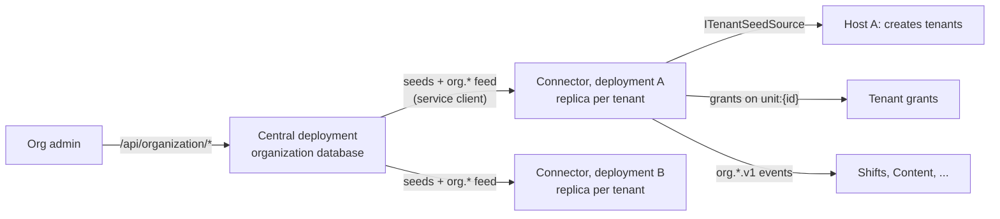

> **Status: implemented** in the repository
> [`ModularBlazor.Module.Organization`](https://github.com/soft-square-net/ModularBlazor.Module.Organization)
> (branch `main`, version 1.0.0-preview.2), in Clean Architecture layers, with the **Organization** client module in
> Arabic and English. The packages `soft.square.net.Organization.Contracts` and `.Client` 1.0.0-preview.1 are
> published; the preview.2 tag (with `UnitCategories`, the F1 picker fix and the live grants) is approved and waits
> for its release run. The central deployment needs **Platform 1.0.0-preview.8**.

**Organization** is an **optional** module. It holds the organization model that the newsroom modules build on:

- customer **orgs** and their **unit tree**: Org → Sector → Department → Section (Desk and Multimedia are Sections);
- the **people** in it, each linked to an identity account by issuer and subject, and their **memberships** and
  **positions** in units;
- the **tenant seeds**: which units get a tenant of their own, in which deployment, on which database server.

[Shifts](/modules/shifts/) and the planned [NewsRoom](/modules/newsroom/) module **require** it. Contents and the
ContentDesigner use it when it is there.

The module's id is `organization`. Its permissions are `org.read`, `org.units.manage`, `org.members.manage` and
`org.seeds.manage`.

## Two modes

The setting `Organization:Mode` picks one of two roles:

| Mode | Where | Does |
| --- | --- | --- |
| **Central** | One deployment: the Organization service | Owns the platform-level `organization` database (not one per tenant) and the management API. Runs the connector too, for its own tenants |
| **Connector** (default) | Every other deployment | Pulls the central service's seeds and feed into a replica in each tenant's database, serves the seeds to the host, writes the positions' grants, republishes the `org.*` events locally and serves the tenant's units |

Several YARP gateways can share one central service. A gateway routes `/api/organization/local/*` to its own
deployment and `/api/organization/*` to the central service.

## The model

| Item | Rules |
| --- | --- |
| Unit types | Per org; each type lists which types it may sit under |
| Units | A tree. A move rebases the subtree. A unit owns a tenant (through a seed) or inherits the tenant of a unit above it |
| Section categories | A Section holds at least one Content category id, or `*` alone, meaning every category. A parent's `CategoriesOf` is the union of its Sections, or `["*"]` if any of them holds it (`UnitCategories` in Contracts) |
| Persons | Identity issuer and subject, with an optional employee profile |
| Memberships | A person in a unit, with an optional position and dates; one primary per person. Times are stored in UTC |
| Positions | Definitions with permissions. Seeded: `unit-admin` (`org.read`, `org.units.manage`, `org.members.manage`, `org.seeds.manage`) and `manager` (`org.read`, `org.units.manage`, `shifts.manage`) |
| Tenant seeds | A unit that gets its own tenant in a deployment. Each edit is a new version; the connector reports its status per version |
| Tenant links | A skeleton only. A future Webhooks module will act on them |

Every write takes the item's `version` and answers **409** if it changed. A save that breaks a unique key or refers
to a removed row is also a 409 that says so; anything else the database refuses is a logged 500 "Not saved".

## Authorization on the central service

Endpoints only need a signed-in caller. What the caller may do comes from the service's own data, never from tenant
permissions:

- **Platform admins** create orgs and may do everything.
- **Org admins** (the org's admin list, by issuer and subject) manage their whole org.
- **Positions:** a membership with a position gives its permissions on that unit and every unit below it.
- **Service clients** (`Organization:ServiceClients`) read deployment seeds and the feed, and report seed status.

Tokens are accepted only from `Organization:TrustedIssuers`.

### Users of other deployments (foreign callers)

A user of deployment B signs in to a tenant that only B knows. The central routes are
[`TenantOptional`](/backend/tenancy-data/#foreign-tenants), so on Platform preview.8 the caller arrives
without a tenant, as a **foreign** caller (`ITenantContext.ForeignTenantId`). The service then **fails closed**:

- The token must be issued for that tenant (`ResolvedBy` is `claim`). A tenant named only by the `X-Tenant` header
  gets 403.
- The caller reaches **only the orgs that have a tenant seed for that tenant id** (any deployment, any status). Inside
  them, the issuer and subject decide as above: org admin, positions (a seed's admins are unit admins of its unit),
  membership.
- The `platform-admin` role and `ServiceClients` do not apply to a foreign caller. The module no longer reads
  `platform-admin` from such a token, so a branch platform admin is not a central admin.

Callers with a tenant the central deployment knows, or with none, are authorized as before.

## The connector

The connector is active once `Organization:CentralUrl` names the central module route. It signs in with a
client-credentials token (`TokenEndpoint`, `ClientId`, `ClientScope`, `ClientSecret`; keep the secret in the host's
configuration as `Modules:Settings:organization:Organization:ClientSecret`).

- **Seeds.** It is the platform's [`ITenantSeedSource`](/backend/tenant-seeds/). The host's reconciler pulls the
  deployment's seeds through it. Every `PollInterval` (30 s) it also pulls them itself and publishes
  `tenancy.seed-changed.v1` when one is new, so the host reconciles at once.
- **Replica.** Per tenant created from a seed, in schema `organization` (tables `replica_*`): every unit of the org, its
  persons and positions, the memberships of the tenant's own units, and the links that name its seed. A new tenant
  gets its first sync before the module serves it. When the central service is down, the replicas keep serving.
- **Grants.** Each membership of a tenant unit with a position becomes standing grants on `unit:{id}` (grant source
  `org:{unitId}`). Every position grant includes `org.read`; the first sync after a process start rewrites all grants,
  so older positions get it too.
- **Events.** It republishes `org.unit-created/updated/moved/removed`, `org.membership-changed`, `org.person-changed`,
  `org.position-changed` and `org.tenant-link-changed` (v1) through the tenant's outbox, with the unit path.
- **Reads.** `IUnitDirectory` (in `Organization.Contracts`): units, ancestors, `CategoriesOf`, `MembersOf`. Other
  modules call the local API below, or use `HttpUnitDirectory`.

| Local route (under `/api/organization`, tenant required) | Does |
| --- | --- |
| `GET /local/units` | The tenant's units and its root's ancestors (`inTenant: false`), root first |
| `GET /local/units/{unitId}`, `.../ancestors`, `.../categories` | One unit, its ancestors, its post categories |
| `GET /local/units/{unitId}/members` | Its memberships (`org.read` on the unit or above it) |

## Scopes and live updates

- `UnitScopes.For(path)` gives `unit:{id}` for a unit and every ancestor (ids in N form, 32 hex digits). A grant on a
  Department therefore covers its Sections. Shifts, Content and ContentDesigner all use it.
- The manifest declares the platform's `unit` topic kind and the module's `org` kind, both with `org.read`. The
  resolver works from the subscriber's tenant replica and fails closed. The org topic
  `organization:org:{orgId:N}` sends `org.changed` with `{ type, id }` after each committed change, without a
  sequence. Subscribers need `org.read` on the org root or on the tenant's seed root (or an ancestor of it).
- Load the module **on the core pool** too: the live hub runs there.

See [Live updates](/backend/live-updates/) for the hub.

## The client

The client module (`/organization`) has the orgs, the unit tree (with a live chip), people, positions, seeds and
links. The Section category picker uses the `content.categories` [lookup](/backend/lookups/) when Contents is
installed, offers an "All categories" row for `*`, and no longer crashes when Contents is installed (fix F1).

The pages show buttons from the token's `platform-admin` role, so a platform admin in a foreign tenant sees buttons
the API refuses.

## Developing and releasing

- **Playground:** two deployments from Platform source: `central` (5081) and a connector `branch-core` behind its own
  gateway (5080), sharing the identity service (5090). `playground/demo.ps1` builds an org, a Section, a manager and a
  seed, waits for the tenant, checks grants, live nudges and the foreign-caller rules. Since preview.8 it needs no stub
  tenant on central.
- **Release:** one version for everything, set in `Directory.Build.props`. `scripts/Pack-Bundle.ps1` writes
  `organization-<version>.zip` (server zip, the two client dlls, the two nupkgs). A `v*` tag that matches the version
  publishes the packages.

Operator docs, in English and Arabic, are in the repository's `docs/en` and `docs/ar`.
