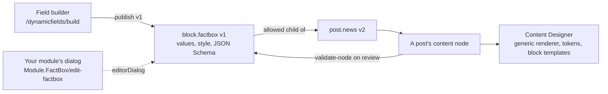

A **field** is one kind of content: a paragraph, an image, a gallery, or a whole post. This tutorial adds a **fact
box**, `block.factbox`: a titled box of short facts that a news story can carry, with an editor of its own. At the end
it can be added to news posts, it is checked on every review step, and it shows in the Content Designer.



## Step 1. Plan the values

Every value has a **key** (its JSON name, fixed once published), a **label**, a **kind**, and the **schema.org
property** it is published as, which is what search engines and AI read.

| Key | Label | Kind | Rules | schema.org |
| --- | --- | --- | --- | --- |
| `heading` | Heading | Text | required, at most 80 characters | `name` |
| `facts` | Facts | Text, multiple | required, each at most 140 characters | `text` |
| `source` | Source | Url | | `isBasedOn` |
| `kind` | Box type | Choice | `numbers`, `timeline`, `glossary` | |
| `image` | Image | Asset | images only (`image/*`) | `image` |

The value kinds are Text, RichText, Integer, Decimal, Boolean, Date, DateTime, Url, Choice, Asset, Keyword, Term and
Lookup. Limits are `minLength` and `maxLength` for text, `minimum` and `maximum` for numbers, `options` for a choice
and `accept` for a file.

The field's schema.org **type** must be one of the curated catalog's (`GET /api/dynamicfields/catalog/schema-org`). A
fact box is a `WebPageElement`.

## Step 2. Create the field

**Who:** someone with `dynamicfields.manage`.

Open **Fields** (`/dynamicfields`) and **New field**. The builder has five sections, in a bar with a count and a ✓ or
! for each:

1. **What it is**: the key `block.factbox`, the title and description, the schema.org type, and whether a post can be
   made of it. A fact box is a block, not a post kind, so leave **can be root** off. Picking a type adds its suggested
   values.
2. **Values**: one card per value. Add the rows of step 1, or pick schema.org properties from the tray below with one
   click.
3. **Style**: the presentation choices an editor may make, as theme tokens. Add the presets **width** and **tone**.
4. **What it can contain**: the fields allowed inside it, with counts. None for a fact box.
5. **Advanced**: the **editor dialog** (step 5).

Beside the form, the **preview** shows the edit form exactly as authors will see it, and the values as JSON-LD. The
**JSON** tab shows the draft. The same draft through the API:

```bash
curl -X POST http://localhost:5080/api/dynamicfields/fields -H "Authorization: Bearer $TOKEN" -H "X-Tenant: daily" \
  -H "Content-Type: application/json" --data @factbox.json
```

```json title="factbox.json"
{
  "key": "block.factbox",
  "draft": {
    "title": "Fact box",
    "description": "A titled box of short facts.",
    "schemaType": "WebPageElement",
    "canBeRoot": false,
    "properties": [
      { "key": "heading", "label": "Heading", "kind": "Text", "required": true, "maxLength": 80, "schemaProperty": "name" },
      { "key": "facts", "label": "Facts", "kind": "Text", "required": true, "multiple": true, "maxLength": 140,
        "schemaProperty": "text" },
      { "key": "source", "label": "Source", "kind": "Url", "schemaProperty": "isBasedOn" },
      { "key": "kind", "label": "Box type", "kind": "Choice", "options": ["numbers", "timeline", "glossary"] },
      { "key": "image", "label": "Image", "kind": "Asset", "accept": ["image/*"], "schemaProperty": "image" }
    ],
    "style": [
      { "key": "width", "label": "Width", "values": ["content", "wide", "full", "half", "third"], "responsive": true,
        "default": "content" },
      { "key": "tone", "label": "Tone", "values": ["default", "muted", "accent", "inverse"], "default": "muted" }
    ],
    "children": [],
    "editorDialog": null
  }
}
```

A broken rule in a draft (a bad key, a choice without options, an unknown schema.org type...) is a **409** that names
the rule. Save as often as you like: only publishing makes it usable.

:::caution[Style is tokens only]
Style values are theme tokens, never CSS or colours. Use the tokens and values of the shared vocabulary (`width`,
`align`, `spacing`, `tone`, `size`, `level`, `aspect`, `columns`, `layout`): MudTail's stylesheet styles exactly
those, and the Content Designer skips anything else. A responsive value may differ per breakpoint:
`{ "base": "full", "md": "half" }`.
:::

## Step 3. Validation: what is checked, and when

You do not write validation code. The field **is** the rules, and DynamicFields checks every content node against the
published version it names:

- the node has exactly the field's values, of the right kinds, with the required ones present;
- each value is within its limits (length, range, options, accepted files);
- the style uses only the field's tokens and values, and known breakpoints (`base`, `sm`, `md`, `lg`, `xl`);
- children are allowed by the parent, within their counts, at the pinned versions;
- a tree has at most 500 nodes and 12 levels.

The checks run at three moments:

| When | Who calls | What fails |
| --- | --- | --- |
| **Save** in the editor dialog | the dialog, `POST /content/validate-node` | each issue shows under its value |
| A content moves into **review** or **accepted** | Content, `validate-node` on the content and its nodes | 422 with `problems`, and the studio's Problems pane |
| The post is **approved, scheduled or published** | Content, `validate` on the whole post | 422; nothing changes |

Try it before anyone writes a real box:

```bash
curl -X POST http://localhost:5080/api/dynamicfields/content/validate-node -H "Authorization: Bearer $TOKEN" \
  -H "X-Tenant: daily" -H "Content-Type: application/json" \
  -d '{ "field": "block.factbox", "fieldVersion": 1, "content": { "heading": "", "facts": [] }, "style": {} }'
```

The answer is `{ valid: false, issues: [{ path, message }], warnings }`, with JSON Pointer paths such as `/heading`.
Only `issues` make content invalid; `warnings` are advice.

## Step 4. Dependencies between values

Not every dependency is built yet. Here is what you have today:

| You want | Today |
| --- | --- |
| One list filtered by another (a city after its country) | **Built.** Two Lookup values, the second with `lookup.parentProperty` naming the first. The editor filters it, and the server checks the saved value's parent. The lookup must have a parent field |
| A cascade over a tree (region › country › city) | **Built.** One Lookup value with `lookup.recursive: true`, optionally `rootKey`, `maxDepth` and `leafOnly` |
| Fixed filters on a pick list | **Built.** `lookup.presetFilters`: chips the editor cannot remove, checked on the server |
| Values edited and reviewed apart (Story, SEO) | **Built**, for post kinds only: value groups (`groups`, and `group` on each value) |
| A value shown or required only when another has some value | **Not built.** Designed in [conditional visibility](/modules/dynamic-fields/conditional-visibility/) |

For the last one, until conditional visibility exists:

- Keep the dependent value **optional** in the field, because the server checks `required` on every node.
- Hide or show it in **your own editor dialog** (step 5), from the other value's state.
- If the rule must hold on the server too, check it in the module that owns the workflow step, not in the field.

## Step 5. Connect an editor dialog

DynamicFields' generic editor, `Module.DynamicFields/edit-content`, builds one control per value. When a field needs
a better one (a live preview, a drag-to-sort list of facts, the visibility rules of step 4), give it a dialog of your
own client module, and name it in the field's **editor dialog**: `Module.FactBox/edit-factbox`.

The contract is the same as `edit-content`: the dialog gets `{ field, version, content, style, nodeId }` and closes
with `{ field, version, nodeId, content, style }`. Keep the node id it was given, or make one (`n` and 12 hex digits),
because translations and design overlays key on it.

```razor title="Module.FactBox/Dialogs/EditFactBoxDialog.razor"
@attribute [ClientDialog("Module.FactBox/edit-factbox", Title = "Fact box")]
@*
  Contract (the same as Module.DynamicFields/edit-content):
    parameters  { field, version?, content?, style?, nodeId? }
    result      { field, version, nodeId, content, style }
*@
@inject IHttpClientFactory Http

<div class="mud-dialog-content">
  <label class="mud-input-label" for="fb-heading">Heading</label>
  <input id="fb-heading" class="mud-input-slot" maxlength="80" @bind="_heading" />

  @for (var i = 0; i < _facts.Count; i++)
  {
    var at = i;
    <input class="mud-input-slot" maxlength="140" value="@_facts[at]" @onchange="e => _facts[at] = (string)e.Value!" />
  }
  <button type="button" class="mud-button-root mud-button-text mud-button-medium" @onclick="() => _facts.Add(string.Empty)">Add a fact</button>

  @if (_kind == "timeline")   @* shown only for timelines: the field keeps "source" optional *@
  {
    <label class="mud-input-label" for="fb-source">Source</label>
    <input id="fb-source" class="mud-input-slot" type="url" @bind="_source" />
  }
  @foreach (var issue in _issues) { <p class="mud-typography mud-error-text">@issue.Path: @issue.Message</p> }
</div>
<div class="mud-dialog-actions">
  <button type="button" class="mud-button-root mud-button-text mud-button-medium" @onclick="Dialog.Cancel">Cancel</button>
  <button type="button" class="mud-button-root mud-button-filled mud-button-primary mud-button-medium" @onclick="SaveAsync">Save</button>
</div>

@code {
  [CascadingParameter] public IDialogReference Dialog { get; set; } = default!;
  private sealed record Parameters(string Field, int? Version, JsonObject? Content, JsonObject? Style, string? NodeId);
  private sealed record Issue(string Path, string Message);
  private sealed record Report(bool Valid, List<Issue> Issues);

  private Parameters _p = default!;
  private string _heading = "", _kind = "numbers";
  private string? _source;
  private List<string> _facts = [];
  private List<Issue> _issues = [];

  protected override void OnInitialized()
  {
    _p = Dialog.GetParameters<Parameters>()!;
    _heading = (string?)_p.Content?["heading"] ?? "";
    _facts = _p.Content?["facts"]?.AsArray().Select(f => (string)f!).ToList() ?? [""];
    _kind = (string?)_p.Content?["kind"] ?? "numbers";
    _source = (string?)_p.Content?["source"];
  }

  private async Task SaveAsync()
  {
    var content = new JsonObject
    {
      ["heading"] = _heading,
      ["facts"] = new JsonArray([.. _facts.Where(f => f.Length > 0).Select(f => JsonValue.Create(f))]),
      ["kind"] = _kind,
    };
    if (_kind == "timeline" && !string.IsNullOrWhiteSpace(_source)) content["source"] = _source;
    var style = _p.Style ?? new JsonObject();
    var version = _p.Version ?? 1;

    // The same check Content will run on review: ask DynamicFields, show its issues, close only when valid.
    var api = Http.CreateClient("api");
    var answer = await api.PostAsJsonAsync("api/dynamicfields/content/validate-node",
        new { field = _p.Field, fieldVersion = version, content, style });
    var report = await answer.Content.ReadFromJsonAsync<Report>();
    _issues = report?.Issues ?? [];
    if (report is not { Valid: true }) return;

    var nodeId = _p.NodeId ?? "n" + Convert.ToHexString(RandomNumberGenerator.GetBytes(6)).ToLowerInvariant();
    Dialog.Close(new { field = _p.Field, version, nodeId, content, style });
  }
}
```

The named HTTP client and the namespaces (`System.Text.Json.Nodes`, `System.Net.Http.Json`,
`System.Security.Cryptography`) depend on your module. See [dialogs between client modules](/guides/module-dialogs/)
for `[ClientDialog]`, `IDialogReference` and `IModuleDialogs`, and [create a module](/backend/create-a-module/) for a
client module of your own.

Then set the field's editor dialog (**Advanced** in the builder, or `"editorDialog": "Module.FactBox/edit-factbox"`)
and save. The id must be `{module id}/{name}`.

:::caution[Who opens the editor dialog]
DynamicFields stores the editor dialog with the field and returns it in every published version (`editorDialog`, also
in the compiled schema). **No consumer opens it automatically yet**: Content's post page and the studio open the
generic `edit-content`. A page of yours opens the right one like this:

```csharp
var version = await Fields.GetFieldVersionAsync("block.factbox", 0);   // 0: the newest published
var dialog = version.EditorDialog is { } id && ModuleDialogs.IsAvailable(id) ? id : "Module.DynamicFields/edit-content";
var result = await ModuleDialogs.ShowAsync(dialog, new { field = "block.factbox", version = version.Version, content, style, nodeId });
```

`Fields` is the DynamicFields API client (`DynamicFieldsClient`). `IsAvailable` falls back to the generic editor when the
user's catalog does not have your module.
:::

## Step 6. Publish the field

**Publish** freezes the draft as **version 1**. Content made with version 1 always validates the same way, even after
you change the draft and publish version 2. A field can be deleted only until it is first published.

```bash
curl -X POST http://localhost:5080/api/dynamicfields/fields/block.factbox/publish -H "Authorization: Bearer $TOKEN" \
  -H "X-Tenant: daily" -H "Content-Type: application/json" -d '{ "version": 1 }'
```

`version` is the draft's concurrency version, read from `GET /fields/block.factbox`; a changed draft answers 409.

## Step 7. Allow it in a post kind

A post may contain only the fields its kind allows. Open `post.news` in the builder, add `block.factbox` under **What
it can contain** (for example at most 3), and **publish** `post.news` again. Publishing pins each child to its newest
published version, so `post.news` v2 allows `block.factbox` v1. Posts made with `post.news` v1 keep their rules.

Now a writer can add a fact box to a news post, as a content of the post, and edit it with the dialog.

## Step 8. See it in the Content Designer

Open a news post with a fact box in the studio (`/contentdesigner/studio/{postId}`):

- The fact box is a **content** of the post: it is in the **Contents** tray with its stage and assignee, and on the
  canvas where the design places it (or in `items`, with every content not placed by name).
- It is drawn by the **generic renderer**. The starter blocks (`block.heading`, `text`, `paragraph`, `quote`, `image`,
  `video`, `audio`, `gallery`) have renderers of their own, with AMP variants; any other field uses the generic one.
  A dedicated renderer is a change to the `ContentDesigner.Rendering` library today.
- **Properties** shows its style tokens (width and tone), per view. The Check compares them with the field's style.
- **Save as block template** keeps how a fact box looks in a view (part order, hidden parts, tokens, optionally
  starting values), for this view or all four. The **Explorer** lists block templates by field and view, to apply to
  the next fact box.
- **Check** validates the post with DynamicFields and builds its JSON-LD: the box's `heading`, `facts` and `image` are
  published under their schema.org properties. Look at the AMP view's problems too.

## Step 9. Route it to the right people (optional)

A content kind is its field key, so the newsroom can treat fact boxes apart:

- a **routing rule** `{ "contentKind": "block.factbox", "unitTag": "data-desk", "order": 1 }` sends every fact box to
  the unit tagged `data-desk`, whose people on shift produce it;
- a **binding** of kind type `content` and kind `block.factbox` runs a sub-workflow of your own for it, instead of
  `newsroom-content`.

See [workflows and assignment](/modules/newsroom/workflows-and-assignment/).

## Checklist

- [ ] The values have stable keys, limits and schema.org properties.
- [ ] Style uses the shared token vocabulary only.
- [ ] Conditional values are optional in the field and handled in the editor.
- [ ] The editor dialog keeps the node id and validates before it closes.
- [ ] The field is published, and the post kind is published again to allow it.
- [ ] The studio's Check passes in all four views, AMP included.
