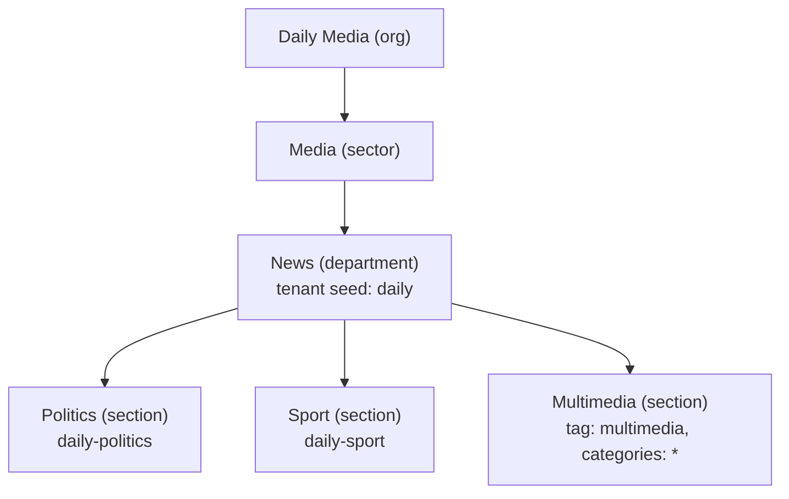

By the end of this tutorial a tenant called `daily` has:

- an organization, **Daily Media**, with a Sector, a **News** Department and two Sections, **Politics** and **Sport**;
- a press, **The Daily**, with the categories `daily-politics` and `daily-sport`;
- a managing editor, a moderator, two writers, a sub-editor and a Desk editor, each with the rights of their job;
- a shift template per Section, and the service accounts the workflow needs.



## The pieces, and who owns them

| What | Owner | Where you set it |
| --- | --- | --- |
| The org, its unit tree, people, memberships, positions, tenant seeds | [Organization](/modules/organization/), central service | `/organization` pages, or `/api/organization` |
| The tenant itself (database, hosts, modules) | The platform host, from Organization's tenant seed | the seed; the host's reconciler provisions it |
| Presses and categories | [Contents](/modules/contents/) | **Contents Management**, or `/api/content` |
| Accounts and tenant membership | The identity service | identity admin, or invitations |
| Standing grants (rights outside a shift) | The host's grant store | `POST /api/identity/grants`, or the member page |
| Shift roles, templates, shifts, attendance | [Shifts](/modules/shifts/) | `/shifts` pages, or `/api/shifts` |
| Post kinds and the proposal form | [DynamicFields](/modules/dynamic-fields/) | `/dynamicfields` |
| Workflow bindings and routing rules | [NewsRoom](/modules/newsroom/) | `/newsroom/admin/*` |

The unit tree lives in the **central** Organization service. Every other deployment runs Organization as a
**connector**: it copies the tree into each tenant, writes the positions' grants there, and republishes the `org.*`
events locally. A single deployment can be both: Central mode runs the connector for its own tenants too.

## Step 1. Create the organization

Sign in as a platform admin (role `platform-admin`) and create the org. Creating it seeds the unit types (`org`,
`sector`, `department`, `section`), the positions `unit-admin` and `manager`, and the root unit.

```bash
curl -X POST http://localhost:5080/api/organization/orgs \
  -H "Authorization: Bearer $ADMIN" -H "Content-Type: application/json" \
  -d '{ "key": "daily-media", "nameEn": "Daily Media", "nameAr": "ديلي ميديا",
        "admins": [{ "issuer": "http://localhost:5090/", "subject": "<managing editor sub>" }] }'
```

`admins` are the org admins, by token issuer and subject: they manage the whole org from now on. The answer has the
org id and its root unit id.

The seeded unit types nest as **org → sector → department → section**, and only a `section` holds categories. Add your
own type with `POST /orgs/{orgId}/unit-types` (`key`, names, `allowedParents`, `holdsCategories`) if your newsroom has
another level, such as a desk inside a Section.

## Step 2. Build the unit tree

Add each unit under its parent. A Department needs no categories; a Section does, and you add the Sections in step 5,
once the tenant has its categories.

```bash
curl -X POST http://localhost:5080/api/organization/orgs/$ORG/units -H "Authorization: Bearer $ADMIN" \
  -H "Content-Type: application/json" \
  -d '{ "parentId": "<root unit id>", "typeKey": "sector", "nameEn": "Media", "nameAr": "الإعلام" }'

curl -X POST http://localhost:5080/api/organization/orgs/$ORG/units -H "Authorization: Bearer $ADMIN" \
  -H "Content-Type: application/json" \
  -d '{ "parentId": "<sector id>", "typeKey": "department", "nameEn": "News", "nameAr": "الأخبار",
        "timeZone": "Africa/Cairo" }'
```

- **Time zone.** Set it on the Department: Shifts plans and shows a unit's shifts on its clock, taken from the
  nearest unit up the tree that has one.
- **Tags** (`tags: ["multimedia"]`) let NewsRoom's routing rules find a unit by role rather than by id.
- **Moving** a unit (`POST .../units/{id}/move`) rebases its whole subtree, and every module that stores unit paths
  follows the `org.unit-moved.v1` event.

The same is on the **Organization** pages (`/organization`): the tree, people, positions and seeds.

## Step 3. Give the newsroom its tenant

A **tenant seed** says that a unit gets a tenant of its own in a deployment. Root it at the News Department, so the
tenant `daily` holds the Department and every Section below it.

```bash
curl -X POST http://localhost:5080/api/organization/orgs/$ORG/seeds -H "Authorization: Bearer $ADMIN" \
  -H "Content-Type: application/json" \
  -d '{ "rootUnitId": "<news department id>", "deploymentId": "central", "tenantId": "daily",
        "name": "The Daily", "hosts": ["daily.localhost"], "databaseServer": "TenantStore",
        "databaseName": "daily", "adminPersonIds": ["<managing editor person id>"] }'
```

The deployment's connector pulls the seed, the host provisions the tenant (its database and migrations), and the
connector reports the state back: wait until the seed shows **Provisioned**. A seed's `adminPersonIds` become unit
admins of its root unit, with `access.grants.manage` in the tenant. See [tenant seeds](/backend/tenant-seeds/).

## Step 4. Create the press and its categories

A **press** is a publication; a post belongs to one press, and all its categories are of that press. Category ids are
your own stable slugs. In the tenant, as someone with `content.manage` tenant-wide:

```bash
curl -X POST http://localhost:5080/api/content/presses -H "Authorization: Bearer $TOKEN" -H "X-Tenant: daily" \
  -H "Content-Type: application/json" -d '{ "id": "daily", "name": "The Daily" }'

curl -X POST http://localhost:5080/api/content/categories -H "Authorization: Bearer $TOKEN" -H "X-Tenant: daily" \
  -H "Content-Type: application/json" \
  -d '{ "id": "daily-politics", "pressId": "daily", "nameEn": "Politics", "nameAr": "سياسة" }'
```

Add `daily-sport` the same way. **Contents Management** (`/contents`) has the same forms.

## Step 5. Add the Sections with their categories

A Section serves the post categories it lists. That list decides two things: which Section's people may work on a
post, and which Section the workflow may file it in (a post goes to a unit only when one of its categories is the
unit's).

```bash
curl -X POST http://localhost:5080/api/organization/orgs/$ORG/units -H "Authorization: Bearer $ADMIN" \
  -H "Content-Type: application/json" \
  -d '{ "parentId": "<news department id>", "typeKey": "section", "nameEn": "Politics", "nameAr": "السياسة",
        "categories": ["daily-politics"] }'
```

- Add **Sport** with `["daily-sport"]`.
- A Section that serves **every** category, such as Multimedia or SEO, lists `*` alone, and gets a tag:
  `"categories": ["*"], "tags": ["multimedia"]`.
- The unit page has a category picker that reads Content's categories when Content is installed.
- Within a few seconds the connector has the new units in the tenant: `GET /api/organization/local/units` with
  `X-Tenant: daily` lists them.

## Step 6. Invite the people

People sign in with an identity account that is a **member of the tenant**. Invite them first. With the
[identity admin](/modules/identity-admin/) module installed, that is its **Members** page (`/identity`) or
`POST /api/identity-admin/members { email, role }`, and an address without an account gets a new one. In a playground,
the dev accounts already exist.

The seed in step 3 names its admin by person id, so in practice you record the managing editor first (below), then
create the seed.

Then record each person in the org, by the same issuer and subject their token carries, and put them in a unit:

```bash
curl -X POST http://localhost:5080/api/organization/orgs/$ORG/persons -H "Authorization: Bearer $ADMIN" \
  -H "Content-Type: application/json" \
  -d '{ "issuer": "http://localhost:5090/", "subject": "<sub>", "displayName": "Mona Adel",
        "email": "mona@daily.example", "employee": { "employeeNumber": "E-104", "jobTitle": "Moderator" } }'

curl -X POST http://localhost:5080/api/organization/orgs/$ORG/memberships -H "Authorization: Bearer $ADMIN" \
  -H "Content-Type: application/json" \
  -d '{ "personId": "<person id>", "unitId": "<politics id>", "positionId": "<position id>", "primary": true }'
```

A person has one **primary** membership and may have others, with optional dates. Shifts allows only members of a
unit, or of a unit above it, on that unit's rota.

## Step 7. Positions: standing rights on a unit

A **position** is a named set of permissions. A membership with a position gives those permissions as standing grants
on `unit:{id}` of that unit, which also covers every unit below it. The connector writes these grants in the tenant and
rewrites them whenever the memberships or the position change.

| Position | Seeded | Permissions | Give it to |
| --- | --- | --- | --- |
| `unit-admin` | yes | `org.read`, `org.units.manage`, `org.members.manage`, `org.seeds.manage` | whoever runs the unit's structure |
| `manager` | yes | `org.read`, `org.units.manage`, `shifts.manage` | the head of a Department or Section: plans its shifts |
| `planning-desk` | add it | `newsroom.moderate`, `newsroom.projects`, `dynamicfields.read` | a standing moderator, outside any shift |
| `editor-in-chief` | add it | `newsroom.projects`, `newsroom.manage`, `contentdesigner.read`, `contentdesigner.arrange`, `contentdesigner.publish` | the managing editor, on the Department |

```bash
curl -X POST http://localhost:5080/api/organization/orgs/$ORG/positions -H "Authorization: Bearer $ADMIN" \
  -H "Content-Type: application/json" \
  -d '{ "key": "planning-desk", "nameEn": "Planning desk", "nameAr": "مكتب التخطيط",
        "permissions": ["newsroom.moderate", "newsroom.projects", "dynamicfields.read"] }'
```

Every position grant in a connector tenant includes `org.read`, whatever the position lists.

## Step 8. Grants on the press or category

A position covers **unit** scopes, but a new post has no unit yet: the workflow sets it later. So the rights to
**write** posts are granted on the post's **press** or **category**, through the host's grant store. The caller needs
`access.grants.manage` in the tenant (a seed admin has it).

```bash
curl -X POST http://localhost:5080/api/identity/grants -H "Authorization: Bearer $TOKEN" -H "X-Tenant: daily" \
  -H "Content-Type: application/json" \
  -d '{ "userId": "<writer sub>", "permission": "content.author", "scope": "category:daily-politics" }'
```

| Who | Permissions | Scope |
| --- | --- | --- |
| Writers | `content.author` | `category:daily-politics` (or `press:daily` for every category) |
| Writers | `newsroom.propose`, `dynamicfields.read` | tenant |
| Moderators | `content.author` (Content makes the draft post as the moderator) | the categories they approve |
| The managing editor | `content.editor`, `content.manage`, `dynamicfields.manage` | `press:daily`, and tenant for the last two |

Grants are checked on every request, so a change applies at once, without a new token. `validFrom` and `validTo` make a
time-boxed grant. The member page in identity admin (`/identity/members/{userId}`) lists a member's standing and shift
grants.

## Step 9. Shift roles: rights only while on duty

The newsroom's daily rights come from **shifts**: a rota member gets their role's permissions from check-in until
check-out (or the end plus the grace period). Nobody on a shift has these rights without checking in.

A tenant starts with three roles:

| Role | Lead | Permissions |
| --- | --- | --- |
| `manager` | yes | `content.accept`, `content.assign`, `content.transfer`, `content.return` |
| `desk` | | `content.publish`, `content.return` |
| `editor` | | `content.review` |

Add the newsroom's own on **Shifts → Roles** (`/shifts/roles`) or the API. A role on a unit overrides the tenant role
of the same key there.

```bash
curl -X POST http://localhost:5080/api/shifts/roles -H "Authorization: Bearer $TOKEN" -H "X-Tenant: daily" \
  -H "Content-Type: application/json" \
  -d '{ "key": "writer", "nameEn": "Writer", "nameAr": "كاتب",
        "permissions": ["content.author", "contentdesigner.read", "contentdesigner.arrange"], "isLead": false }'
```

Useful additions: a `writer` role as above, and a `moderator` role with `newsroom.moderate` for moderation done on
shift. The permissions must exist in the platform's catalog (an installed module's), or the call is 400.

## Step 10. Plan the shifts

1. **Template.** On **Shifts → Templates** (`/shifts/templates`), give each Section its recurring shift: a start
   time on the unit's clock, a duration, slots per role (one `manager`, two `writer`, one `desk`...) and default
   members.
2. **Clone** the template into a date: it makes a **Draft** shift, with warnings for anyone who is no longer a member
   or whose role no longer holds.
3. **Publish** the shift. A published shift needs exactly one lead.
4. On the day, each member checks in on **My shifts** (`/shifts/mine`), from 30 minutes before the start. The lead
   or a manager can check someone in. Their grants start then, on the Section's `unit:` scope and its categories.
5. The **shift clock** marks absences, checks everyone out at the end plus the grace (15 minutes by default) and ends
   the shift. The lead writes the **handover** note for the next shift.

A manager position on the Department (`shifts.manage` on its `unit:` scope) can plan the shifts of every Section below
it.

## Step 11. The post kinds and the proposal form

As someone with `dynamicfields.manage`:

1. Open **Fields** (`/dynamicfields`) and install the **Starter library**. This creates and publishes the block fields
   and the eight post kinds (`post.article`, `post.news`, `post.video`, ...), each with its URL prefix.
2. Create the proposal form, `proposal.default`, once per tenant: DynamicFields has no starter for it. Post the
   recommended definition from NewsRoom's repository (`docs/proposal.default.json`), then publish version 1:

   ```bash
   curl -X POST http://localhost:5080/api/dynamicfields/fields -H "Authorization: Bearer $TOKEN" -H "X-Tenant: daily" \
     -H "Content-Type: application/json" --data @proposal.default.json
   curl -X POST http://localhost:5080/api/dynamicfields/fields/proposal.default/publish -H "Authorization: Bearer $TOKEN" \
     -H "X-Tenant: daily" -H "Content-Type: application/json" -d '{ "version": 1 }'
   ```

   Keep it a non-root field, and keep its `title` value. Until it is published, proposals can be saved but not
   submitted.

## Step 12. Bind the workflow and the routing

As someone with `newsroom.manage` (on **NewsRoom → Admin**):

- **Bindings** (`/newsroom/admin/bindings`): bind each post kind to a workflow on the Department. Elsa ships
  `newsroom-post` for posts and `newsroom-content` for their contents. A binding on the Department applies to its
  Sections unless one has its own. A post kind with no binding is a **setup error** on its projects.

  ```bash
  curl -X POST http://localhost:5080/api/newsroom/bindings -H "Authorization: Bearer $TOKEN" -H "X-Tenant: daily" \
    -H "Content-Type: application/json" \
    -d '{ "kindType": "post", "kind": "post.news", "unitId": "<news department id>", "definitionId": "newsroom-post" }'
  ```

- **Routing rules** (`/newsroom/admin/routing`, tenant-wide): which unit makes a content kind. For example, images and
  videos go to the unit tagged `multimedia`: `{ "contentKind": "block.image", "unitTag": "multimedia", "order": 1 }`.
  A content with no rule stays with the post's Section.

## Step 13. The service accounts

The workflow runs as the service client `elsa-workflows`. Grant it, **tenant-wide, in each tenant**:

| Permission | Why |
| --- | --- |
| `content.assign`, `content.transfer`, `content.publish` | assigning work in the shift, handing it over, publishing |
| `content.unit.assign` | filing a post in its Section and a content in its unit (nobody else holds it) |
| `shifts.manage` | reading overdue and ended shifts |
| `newsroom.workflow` | reading projects, reporting their states, bindings, routing and workload |
| `org.read` | finding a unit's managers when a deadline passes |
| `dynamicfields.read` | publishing: Content checks the post as the caller |

Also set Elsa's `Elsa:Newsroom:ProjectWorkflow`, and give the ContentDesigner's own service client `newsroom.projects`
tenant-wide (read only), so the studio can tell whether a post has a project. Set `NewsRoom:ApiBaseUrl` and
`Content:ApiBaseUrl` to the gateway: until then NewsRoom answers 503 and Content cannot read post kinds or units.

:::caution[Who assigns work]
Content's setting `Content:Newsroom:WorkflowOwnsAssignment` is `false` by default: the shift manager accepts and
assigns by hand. Set it to `true` only once the workflow runs, because then only `content.unit.assign` (the workflow)
may accept, assign, transfer and return.
:::

## Who holds what

| Person | Standing (position or grant) | On shift (role) |
| --- | --- | --- |
| Managing editor | org admin; `editor-in-chief` on the Department; `content.editor`, `content.manage`, `dynamicfields.manage` | |
| Section head | `manager` on the Section (plans its shifts) | `manager` (lead): accept, assign, transfer, return |
| Moderator | `planning-desk` on the Department, or none | `moderator`: `newsroom.moderate` |
| Writer | `content.author` on its categories; `newsroom.propose`, `dynamicfields.read` | `writer`: `content.author`, studio access |
| Sub-editor | | `editor`: `content.review` |
| Desk editor | | `desk`: `content.publish`, `content.return` |
| `elsa-workflows` | the grants of step 13, tenant-wide | |

Next: [2. The life of a post](/tutorials/post-lifecycle/).
