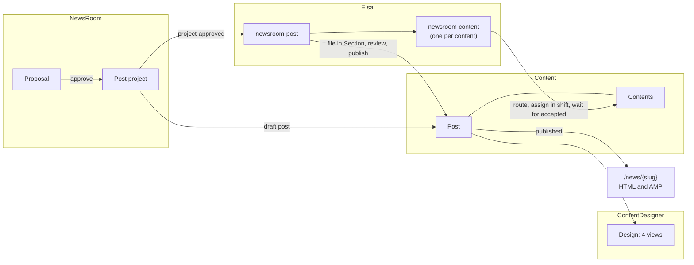
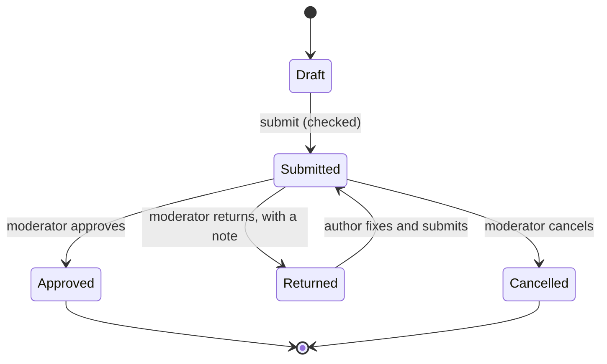
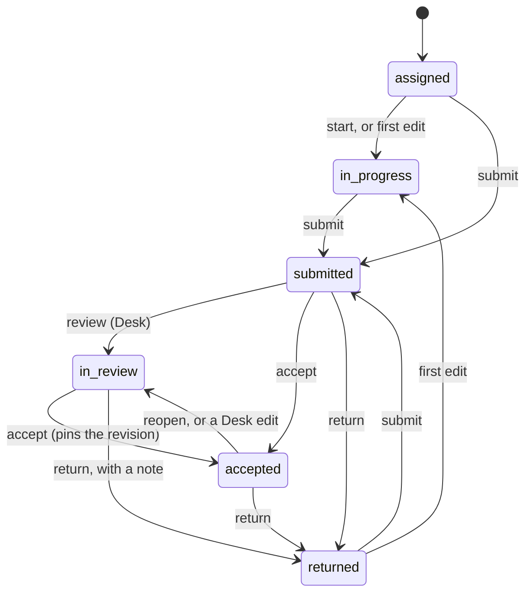
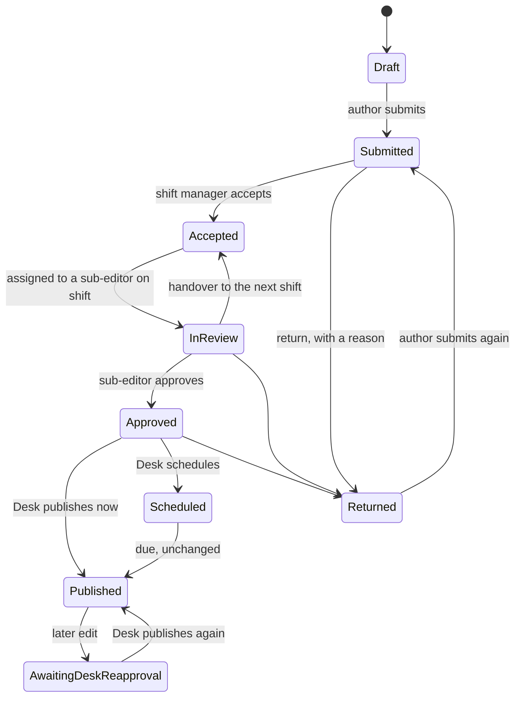

A **post** is any creative work the newsroom publishes: a news story, an article, a review, a video, a reportage, a
photo story. What kind it is comes from its **post kind**, a DynamicFields root field such as `post.news`, which also
gives it a URL prefix (`/news/...`). This tutorial follows one news story through the tenant set up in
[tutorial 1](/tutorials/newsroom-setup/).

A post is made of **shared contents**: its paragraphs, images, videos and quotes are each a content of Content's
library, with their own stage, assignee and revisions. Sections work on the contents; the Desk reviews the post.

There are two ways in. With **NewsRoom**, a story starts as a proposal and the workflow drives it. Without NewsRoom, an
author creates the post directly in Contents Management and people move it by hand; that path is at the
[end of this page](#without-newsroom).

## Stage 1. The proposal

**Who:** a writer with `newsroom.propose` (and `dynamicfields.read`).

1. Open **NewsRoom → My proposals** (`/newsroom/proposals`) and **New proposal**. The form is the tenant's
   `proposal.default`: a title, an image, a body, and whatever the tenant added. Pick the unit the proposal belongs to,
   and suggest categories (`daily-politics`).
2. **Save draft** as often as you like. A draft is incomplete by design and only its author sees it.
3. **Submit.** NewsRoom checks the values against the newest published `proposal.default`. A 422 lists the problems
   by field; nothing is submitted unchecked, and if DynamicFields cannot answer the answer is 503.

The author edits only while the proposal is Draft or Returned, and cannot withdraw it once submitted.

## Stage 2. Moderation

**Who:** a moderator: `newsroom.moderate` on a unit that covers the proposal, from a position (the planning desk) or
from a shift role while checked in. They also need `content.author` in the categories, because Content creates the
draft post as them.

1. The **Moderation queue** (`/newsroom/queue`) lists the submitted proposals of the units they moderate, oldest
   first.
2. **Return** it with a note, **cancel** it, or **approve** it. Approving adds one line per post the story becomes (1
   to 10): the post kind (`post.news`), the Section that will produce it (NewsRoom suggests the Sections whose
   categories match), and the categories, primary first.
3. One story can become several posts: a news post now and a video later are two lines, two posts and two projects,
   each with its own kind, Section and workflow.

For each line NewsRoom saves a **post project**, and Content creates the **draft post**: the kind's root with the
proposal's title as its `headline`, its image and body where the kind has matching values, and the categories. The
post has **no unit** yet. When the project has its post, NewsRoom publishes `newsroom.project-approved.v1`.

If Content cannot make the draft, the approval stands; the project page shows the error and **Retry** makes the draft
safely, without a second post.

## Stage 3. The workflow files the post

**Who:** Elsa, as `elsa-workflows`. The event starts the workflow **bound** to the post kind on the Section (for
example `newsroom-post`). A kind without a binding is a setup error on the project, and the workflow starts as soon as
a binding exists.

1. **Filing.** `EnsurePostInUnitCategories` checks that one of the post's categories is the Section's. If so it sets
   the post's unit, and the project goes to **InProduction**.
2. If not, the project goes to **NeedsModeration** with the reason, the post's unit is cleared, and the workflow waits.
   The moderator **fixes** the project (other categories, Section or kind) on its page; that approves it again and the
   check runs again. The workflow never fails over this.
3. Only the workflow holds `content.unit.assign`, so nobody can set a post's unit by hand and skip the check.

## Stage 4. The contents are produced in the shift

A post's body is its contents. The writer adds them on the post page in Contents Management, or adds an existing one
from the shared library in the studio. For **each content**, the post workflow starts a sub-workflow
(`newsroom-content`, or the one bound to that content kind):

1. **Route** it: NewsRoom's routing rules give the unit that makes this content kind (images to the unit tagged
   `multimedia`); with no rule, the post's Section.
2. **Assign in the shift**: the shift manager has a short delay to assign it by hand; otherwise it goes to the
   least-loaded holder of the role who is **checked in** to a running shift of that unit.
3. **Wait** until the content is accepted. A deadline can escalate to the shift's lead, else the unit's managers.
4. At **handover**, unfinished work moves to the next shift of the unit.

Each content moves through its own stages, which are its work-item states:

Every move into a review or accepted stage first runs DynamicFields `validate-node` on the content. A problem is a 422
with `problems: [{ path, message, nodeId }]`, nothing moves, and the refusal shows in the studio's Problems pane.
Every edit of a content is a new **revision**; accepting pins the revision the post will publish.

## Stage 5. Writing the post and arranging it

**Who:** the writer, with `content.author` and, on shift, the studio rights.

- **The kind's values.** On the post page, **Edit values** opens DynamicFields' editor on the post's root: the
  headline, summary, image, keywords and the rest of the kind. A kind with value groups shows them as sections
  (**Story**, **Search and sharing**). The required ones must be filled before the post can be approved or published.
- **The design.** The studio (`/contentdesigner/studio/{postId}`, opened from the ContentDesigner's designs page by
  the post's row or id) arranges the post in four views:
  Mobile, Tablet, Desktop and AMP. Drag contents onto the canvas, set their tokens (width, alignment, tone...), apply
  a document template or block templates, and edit plain text in place. Text edited on the canvas is saved through
  Content, as a new revision of that content.
- **Checks.** **Check** runs the designer's rules and DynamicFields' validation and JSON-LD. Parts with a problem get a
  dashed outline; errors block publishing, warnings do not.
- **Rights follow the shift.** When the writer checks out, the studio shows **"Your shift ended"**, keeps unsaved work
  in the browser and opens again when the rights return.

## Stage 6. Review and the Desk

The post has its own states, beside the contents':

1. The writer **submits** the post (**Submit for review**). The workflow's Desk review moves the project to
   **ReadyForDesk**.
2. The shift manager **accepts** it into the shift's queue (**Accept into shift**) and **assigns** a sub-editor who is checked in with
   `content.review` on the post. With `Content:Newsroom:WorkflowOwnsAssignment` on and a reviewer role set in the
   workflow, the workflow does both after a delay, never picking the post's owner.
3. The sub-editor **approves** it, or **returns** it with a reason; a returned post goes back to production, then to the
   Desk again.
4. The Desk (`content.publish` on shift) **publishes** it now or **schedules** it. Approve, schedule and publish first
   run DynamicFields `validate` on the whole post (422 on any problem), and every **required** content must have an
   accepted revision.

Where NewsRoom runs, the studio publishes a post's **design** only while its project is **InProduction** or
**ReadyForDesk**; it says why otherwise.

## Stage 7. Published

- The post is served at its canonical path, `/{urlPrefix}/{slug}` (`/news/final-day-at-the-venue`), from the
  **published snapshot**: the pinned revisions, never a newer draft. `GET /api/content/public/{publicId}` is its
  permanent, anonymous address.
- The ContentDesigner renders it as a responsive page (`/api/contentdesigner/render/{publicId}`) and an AMP page
  (`.../amp`), with its JSON-LD.
- NewsRoom follows Content: the project becomes **Published**, and the workflow tells the proposal's author.
- **Later edits** send the post to **AwaitingDeskReapproval**. The live version stays online until the Desk publishes
  the new one. An edit before a scheduled time cancels the schedule.
- **Translations** are overlays per language, kept beside the source; a changed source marks its translations stale.
- **Killing** a project stops its workflow before publication. The post stays in Content, and a scheduled post must be
  unscheduled there.

## The whole life in one table

| Step | Who | Module | Post | Project | Contents |
| --- | --- | --- | --- | --- | --- |
| Propose, submit | writer | NewsRoom | | | |
| Approve | moderator | NewsRoom, Content | Draft, no unit | Approved | |
| File in Section | workflow | Elsa, Content | Draft, unit set | InProduction | |
| Produce | writers on shift | Content, Studio | Draft | InProduction | assigned → accepted |
| Submit, review | writer, manager, sub-editor | Content | Submitted → Approved | ReadyForDesk | accepted |
| Publish | Desk | Content, Studio | Published | Published | pinned |
| Edit later | writer, Desk | Content | AwaitingDeskReapproval → Published | Published | new revisions |

## Without NewsRoom

The same post can start in **Contents Management** (`/contents`):

1. **New post**: pick the press, the primary category and others, and the **kind** from the tenant's published post
   kinds. The author needs `content.author` in each category.
2. Fill in the kind's values, add contents, arrange it in the studio.
3. **Submit**, then the shift manager accepts and assigns, the sub-editor approves and the Desk publishes, as in
   stage 6. The post has no unit unless a workflow sets one, so its rights come from its press and categories.

Next: [3. A new field and its editor](/tutorials/custom-field/).
